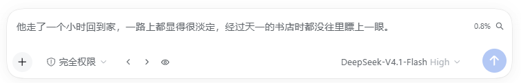

# DSH Fish Reader User Guide

DSH Fish Reader is a local TXT / EPUB reader for DeepSeek Harness. It shows a novel inside the composer placeholder without adding a row or changing the composer height.

Books and progress stay on your machine. Reading never sends a chat message or calls a model.

The text appears in the composer placeholder, with the page controls beside **Full access** and progress/search on the right.

## Features

- Import local TXT / EPUB novels.
- Detect UTF-8, UTF-16, UTF-32, GB18030 and Big5 encodings.
- Remember a separate reading position for each book.
- Fit one line to the composer width.
- Previous / next page, show / hide, auto-hide.
- Plain-text search, regex search, find previous / next.
- Jump by percentage, such as `12%`, `12.5%` or `100%`.
- Customizable shortcuts.
- Deleting a library entry does not delete the original file.

## Quick start

1. Click the book icon at the bottom of the left sidebar to open the **DSH Fish Reader library**.
2. Click **Import TXT / EPUB** and choose one or more novels.
3. Click **Open** or **Continue**.
4. When the composer is empty, unfocused and the reader is not hidden, the novel appears in the composer placeholder.
5. Click the composer to enter input mode; the novel hides and you can type normally.

## Input mode and reading mode

- **Reading mode**: the novel is shown in the composer placeholder.
- **Input mode**: clicking the composer hides the novel and restores the native placeholder.
- After entering input mode, clicking outside the composer does **not** automatically return to the novel.
- To resume reading, use one of these explicit actions:
  - the eye button in the composer toolbar;
  - `Alt+/`;
  - open / continue a book from the library;
  - previous / next while reading is hidden but you are not in input mode.

In input mode, previous / next do nothing and never advance the book silently.

## Toolbar

The composer toolbar has three buttons beside **Full access**:

- **Previous**: go back one page.
- **Next**: go forward one page.
- **Eye**: show / hide the reader.

When no book is open, all three look the same but are disabled. The eye icon does not change shape when the reader is hidden.

The right side of the reading line shows the progress (for example `12.5%`) and a search button.

## Search and jumps

Press `Alt+F`, or click the search icon at the right of the reading line.

### Plain search

- Type text and use the left / right arrows to find previous / next.
- `Enter` finds next; `Shift+Enter` finds previous.
- The search box stays open after a hit and shows the current match, for example `3/17`.
- Search does not wrap around.

### Regex search

- Click **Regex** in the search box.
- Enter a JavaScript regular expression without `/.../`; it uses the `u` flag and is case-sensitive.
- Examples: `\d+`, `Chapter\s+\d+`.
- In regex mode, `12.5%` is treated as a regex, not a percentage jump.

### Percentage jump

In plain mode:

- `0%`: beginning;
- `12%` / `12.5%`: jump to that position;
- `100%`: last page.

## Shortcuts

| Shortcut | Action |
| --- | --- |
| `Alt+,` | Previous page |
| `Alt+.` | Next page |
| `Alt+/` | Show / hide reading |
| `Alt+F` | Search / percentage jump |

Change them in **Library → Settings → Shortcuts**. A custom shortcut must include Alt, Ctrl or Meta.

## Settings

The library **Settings** page controls:

- maximum characters per segment (default 50; reduced automatically in narrow windows);
- auto-hide delay (default 30 seconds; 0 disables it);
- whether the next segment trims surrounding whitespace;
- shortcuts for previous, next, show/hide and search.

## Data and privacy

- Book text is stored in local IndexedDB.
- Settings, library metadata and progress are stored in localStorage.
- No chat messages, network requests or model calls.
- Deleting a library entry removes only the imported copy and progress, never the original file.
- Different browser profiles do not share a library.

## FAQ

### The novel disappeared after I clicked the composer

That is input mode. The native composer placeholder returns so you can type.

### Clicking outside did not bring the novel back

Input mode is intentionally sticky. Use the eye button, `Alt+/`, or open / continue from the library.

### The three toolbar buttons disappear while a reply is generating

The host replaces the composer tool row with its activity view. The buttons return when generation finishes.

### Import failed

- If every file fails, an error summary is shown.
- TXT import rejects obvious binary or heavily corrupted content.
- EPUB import extracts text only; DRM, images, CSS layout and EPUB navigation are not supported.
- Very large books are limited by browser memory.

### Regex search is slow

Regex search scans the whole book. Very complex expressions can take a long time; prefer a more specific pattern.

## Compatibility

Tested on DeepSeek Harness `0.2.2-rc.5` Desktop (Windows). Host layout changes may require adapting the overlay position.
